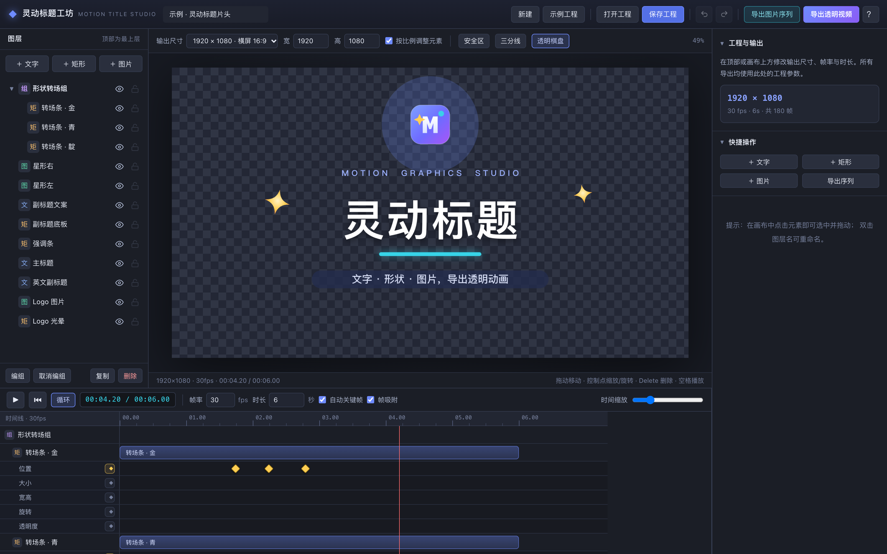

# 灵动标题工坊 · Motion Title Studio

一个**零安装、零依赖、完全本地运行**的动态图形标题制作工具：在画布上分层摆放
**文字 / 矩形 / 图片**，在时间线上为 **位置、大小（缩放）、宽高、旋转、透明度**
打关键帧并选择缓动，然后导出带透明通道的 **PNG 图片序列（ZIP）** 或 **透明 WebM 视频**。

纯原生 HTML + CSS + Canvas2D + JavaScript 实现，没有任何 CDN / 外网字体 / npm 依赖，
所有示例素材均在仓库 `assets/` 与 `js/sample-assets.js` 本地提供。



*上图：内置示例工程的结尾停留画面（左侧图层与编组、下方时间线关键帧、右侧属性检查器）。*

---

## 快速开始

### 方式 A：一体化本地服务器（推荐，支持一键导出真正的透明视频）

需要 Python3（macOS 自带）。它在静态托管之外，额外提供调用本机 ffmpeg 的编码接口
（未安装 ffmpeg 也不影响其他功能与 PNG 序列导出）：

```bash
cd 13929/repo
python3 tools/studio_server.py 8123
# 浏览器打开 http://127.0.0.1:8123/
```

macOS 也可以直接**双击 `启动工具.command`**，会自动执行上面的命令并打开浏览器。

### 方式 B：任意静态服务器

```bash
cd 13929/repo
python3 -m http.server 8123
# 浏览器打开 http://localhost:8123
```

> 直接双击 `index.html` 也能打开，但 Chrome 在 `file://` 下可能限制 canvas 导出，
> 因此推荐使用本地服务器。浏览器建议使用桌面版 **Chrome / Edge**。
> 若想要 App 内一键得到 alpha/帧率/时长都精确的透明 WebM/MOV，请用方式 A
> （并 `brew install ffmpeg`）。

打开后会自动载入内置示例工程（若浏览器有自动暂存，则恢复上次编辑的工程；
点顶部「示例工程」可随时重新载入）。

---

## 功能与题目要求对照

| 要求 | 实现 |
| --- | --- |
| 文字、矩形、图片分层摆放 | 左侧图层面板，可无限添加、拖拽排序、复制、删除、重命名；图片从本地选择并内嵌为 dataURL |
| 位置 / 大小 / 旋转 / 透明度关键帧 | 时间线每个图层含 **位置、大小、宽高、旋转、透明度** 5 条轨道；检查器与轨道行都有 `◆` 打点按钮 |
| 关键帧缓动 | 点击时间线上的关键帧 `◆`，右侧面板可选 线性 / 缓入 / 缓出 / 缓入缓出 / 二次曲线 / 回弹 / 弹性 等 10 种 |
| 拖动时长、关键帧处不跳变 | 直接左右拖动 `◆` 改变时刻（支持帧吸附），拖动片段条两端改入/出点；采样器在关键帧边界左右取到完全相同的值，数学上保证连续 |
| 安全区 + 多种输出尺寸 | 93% 动作安全区、90% 标题安全区、三分线；内置 16:9 / 9:16 / 1:1 / 4:5 / 720p / 4K 预设与自定义宽高 |
| 改尺寸后位置按比例调整 | 切换尺寸时 `x *= 新宽/旧宽`、`y *= 新高/旧高`，关键帧数值与字号/圆角一并按比例换算（可勾选关闭） |
| 锁定 / 隐藏 / 编组 | 每行眼睛、锁；`⌘/Ctrl+G` 编组、`⌘/Ctrl+Shift+G` 取消编组；编组支持折叠、批量隐藏/锁定、拖拽入组 |
| 导出顺序 = 预览顺序 | 预览与导出共用 `js/renderer.js` 的同一个 `renderFrame()`，按同一份图层树倒序绘制 |
| 保存工程后继续编辑 | 「保存工程」下载自包含 `*.mgs.json`；「打开工程」恢复；另有 localStorage 自动暂存，刷新自动恢复 |
| 透明图片序列 + 视频，保留帧率时长 | PNG 帧数严格为 `round(duration × fps)`；视频用 `captureStream(fps/0 + requestFrame)` 按帧表实时录制，时长 = `duration` |
| 示例工程 | 启动即载：主/副标题依次进场、三条形状条扫屏转场、Logo 与星形回弹落入，最后约 3 秒结尾停留 |

其他：撤销/重做、快捷键、画布直接移动/八向缩放/旋转、投影、文字多行与中英混排换行、
图片 contain/cover/fill、透明棋盘背景、进度条、导出结果提示。

---

## 导出方式（重点）

点击右上角「导出图片序列」或「导出透明视频」。导出期间请保持页面在前台。

### 1. 透明 PNG 图片序列（推荐，必定可靠）

- 得到 `工程名_PNG序列_宽x高_fpsfps_帧数帧.zip`
- 解压后：
  - `frames/frame_0001.png`、`frame_0002.png` … 带 **alpha 透明通道**
  - `README_导出说明.txt`：参数与 ffmpeg 命令
- 帧数 = `round(时长秒 × 帧率)`，例如 6 秒 30fps = **180 帧**，帧率与时长完整保留。
- ZIP 由仓库内自带的零依赖 ZIP/CRC32 写入器（`js/zip.js`）在浏览器本地生成，不上传任何数据。

### 2. 导出透明视频

**方式一（最省心）：一体化服务器 + 本机 ffmpeg。**
用 `python3 tools/studio_server.py 8123`（或双击 `启动工具.command`）启动，
并确保已安装 ffmpeg（macOS：`brew install ffmpeg`）。打开「导出透明视频」时
面板会显示「已连接本地编码服务」，可选择：

- **VP9 WebM（`yuva420p`）**：网页透明背景；
- **ProRes 4444 MOV（`yuva444p10le`）**：Final Cut / Premiere / DaVinci 透明轨道。

它由逐帧 PNG 直接编码，帧率严格为工程 fps、时长严格为 `duration`，alpha 完整保留。

**方式二：PNG 序列 + ffmpeg 命令**，见下一节（质量与兼容性同样最好）。

**方式三（兜底）：浏览器实时录制 WebM。**
用普通静态服务器 / file:// 打开、且没有本地编码服务时，App 会用
`MediaRecorder + canvas.captureStream` 实时录制。注意：桌面 Chrome 当前的
MediaRecorder 通常**不会写入 alpha 通道**（导出的 WebM 背景为黑色），
帧率元数据也可能不规范；因此透明交付请优先使用方式一/二。
普通 H.264 MP4 **不支持透明通道**，请勿用 MP4 交付透明背景。

### 3. 用 PNG 序列合成专业透明视频（ffmpeg）

先安装 ffmpeg（macOS：`brew install ffmpeg`），然后二选一：

```bash
# 方式 A：仓库脚本，一次生成 ProRes MOV + VP9 WebM
unzip 工程名_PNG序列_*.zip -d seq
./tools/frames_to_video.sh seq/frames 30 title_alpha

# 方式 B：手动命令（注意把 30 / %04d 换成你的帧率与序号位数）
cd seq

# ProRes 4444 .mov —— 透明通道，Final Cut / Premiere / DaVinci 推荐
ffmpeg -framerate 30 -i frames/frame_%04d.png \
  -c:v prores_ks -profile:v 4444 -pix_fmt yuva444p10le title.mov

# VP9 WebM —— 网页透明背景
ffmpeg -framerate 30 -i frames/frame_%04d.png \
  -c:v libvpx-vp9 -pix_fmt yuva420p -b:v 0 -crf 30 title.webm

# QuickTime Animation —— 无损 alpha
ffmpeg -framerate 30 -i frames/frame_%04d.png \
  -c:v qtrle -pix_fmt argb title_qtrle.mov
```

---

## 工程文件

- 保存产物：`工程名.mgs.json`（本质是带 `app: "motion-title-studio"` 标记的 JSON）。
- 用户导入的图片会通过 FileReader 转成 dataURL 内嵌，因此工程文件是**单文件自包含**的，
  移动 / 发送给别人后仍可打开。
- 自动暂存键：localStorage `motion-title-studio:autosave:v1`。
  想恢复出厂示例：顶部「示例工程」，或在浏览器控制台执行
  `localStorage.removeItem('motion-title-studio:autosave:v1')` 后刷新。

---

## 操作速览

- **空格** 播放/暂停　**⌘/Ctrl+Z / Shift+Z** 撤销重做
- **⌘/Ctrl+S** 保存工程　**⌘/Ctrl+O** 打开工程
- **⌘/Ctrl+G / Shift+G** 编组 / 取消编组　**⌘/Ctrl+D** 复制　**Delete** 删除
- 画布：拖动移动；白色方块缩放；顶部青色圆点旋转（旋转按 Shift 吸附 15°）
- 时间线：单击标尺定位播放头；上下拖动 `◆` 改关键帧时刻；双击轨道空白处在该时刻打点；
  拖动片段条整体移动，拖两端改入/出点
- 检查器：点 `◆` 打点；选中关键帧后可在顶部黄色面板改时间与缓动

---

## 目录结构

```
repo/
├── index.html               # 单页应用外壳
├── 启动工具.command          # macOS 双击启动
├── css/main.css             # 全部样式（深色专业工具风）
├── js/
│   ├── util.js              # DOM/数学/下载等工具
│   ├── icons.js             # 内联 SVG 图标
│   ├── easing.js            # 10 种缓动（端点严格 0/1）
│   ├── model.js             # 工程/图层模型、树操作、尺寸换算、存档归一化
│   ├── sample-assets.js     # 示例 SVG 素材（dataURL）
│   ├── sample.js            # 内置示例工程
│   ├── interpolate.js       # 关键帧采样（连续性保证）
│   ├── renderer.js          # Canvas 渲染（预览/导出共用）+ 安全区
│   ├── zip.js               # 零依赖 ZIP(STORE+CRC32)
│   ├── exporter.js          # PNG 序列 / WebM / 当前帧导出
│   ├── storage.js           # 工程文件与 localStorage
│   ├── history.js           # 撤销重做
│   ├── app.js               # 状态、动作、快捷键、播放循环
│   └── ui/                  # 图层 / 检查器 / 时间线 / 画布 / 弹窗
├── assets/                  # 本地 SVG 素材源文件
├── tools/frames_to_video.sh # PNG 序列转透明视频脚本
└── tests/                   # 验证脚本（逻辑单测 + Playwright E2E）
```

## 自检 / 测试（可选）

```bash
node tests/logic.test.js     # 插值连续性、比例换算、归一化、CRC 等纯逻辑测试

python3 -m http.server 8123 &
python3 tests/e2e_smoke.py   # Playwright 冒烟（截图/交互/尺寸换算）
python3 tests/e2e_export.py  # 真实导出 ZIP/WebM 并用 ffprobe 校验
```

## 浏览器兼容

推荐 Chrome / Edge ≥ 100。用到的能力：Canvas2D、MediaRecorder、
`canvas.captureStream`、ResizeObserver、DataView（ZIP）。不需要联网，不收集任何数据。
